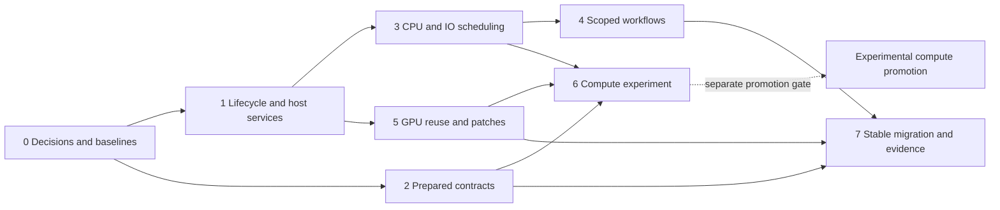

# Revenant owned native workflows — milestone and implementation plan

> **Status: implementation authorized, 2026-10-09.** Beads owns execution status.
> Implement all eight phases on the existing unpublished main. Publication is not
> authorized. The approved implementation amendments below supersede alternatives
> and application-migration requirements elsewhere in this original specification.

Local framework implementation and packaged-fixture evidence are recorded in
[the integration report](../research/2026-10-09-native-workflows-integration.md).
The compute experiment completed with a no-go promotion result. Unavailable
physical/platform evidence and the original restart finding remain visible;
application migration and publication are separate work.

## Approved implementation amendments

- Framework and representative fixtures are the delivery scope. Strata refactoring,
  first-useful-map timing and real application scan comparisons remain follow-ups.
- Core scope admission issues identities itself: instance identity plus a non-reused
  sequence, active-only ancestry, no caller-named admission or historical ledger.
- First public transition: manifest 6 / protocol 5 / SDK revision 4; layout remains 3,
  package versions remain 0.4.0. Existing call/run/query/checkpoint APIs remain.
- Scheduling interfaces belong to core and the executor to desktop. Initial CPU and
  blocking-I/O budgets are four each with queue capacity 32, an interactive CPU
  reserve, cooperative nested work and separately accounted bounded storage.
- Consumer upgrade/recovery acceptance uses isolated reference copies and a non-disk
  standalone fixture. Never patch consumer SDK snapshots manually.
- Complete the restricted compute experiment with a measured go/no-go decision;
  public promotion requires correctness and transfer-inclusive usefulness. A no-go
  is an experiment outcome, never a claim of accelerated application performance.
- Commit, push, remote sync, CI dispatch and release publication remain unauthorized.

**Goal:** make complex native applications faster, simpler to author and harder to
get wrong by owning the repeated scheduling, lifetime, projection and graphics
work demonstrated by Strata.

**Architecture:** retain Rust as the authoritative application/contract source
and Svelte as the interface. Extend existing scoped resources, prepared operations
and native graphics with bounded host services and explicit dataflow; carry small
typed commands/results over the bridge and keep bulk data native.

**Stack:** current Rust workspace, generated TypeScript client and Svelte,
Tauri desktop host, optional wgpu 30.0.1/DX12 graphics on Windows. General numerical
GPU compute is a gated experiment, not a capability the current framework has.

**Milestone:** `revenant-378`. **Planning task:** `revenant-ldj.33`.
**Date:** 2026-10-09. No release number or delivery date is assigned.

---

## 1. Source of the plan and the intended result

The evidence is the Strata developer audit (historical local evidence; not included in this checkout),
its source inventory and measurements, and the existing framework findings
`revenant-ldj.24` through `.32`. Earlier unresolved issues `.18`, `.17.2` and `.20`
also matter: lifetime history, SDK source truth and restart behavior underpin the
new conveniences. The consumer is now at
`<strata-checkout>`; older evidence records its former path.

Revenant already removes handwritten Rust–Svelte transport and type mirrors. The
missing next layer is **expressing native work and its dependencies without
hand-building threads, stale-result arbitration, resource transitions and GPU
setup in every application**.

Successful delivery must change the authoring experience, not merely add features:

- An ordinary replacement read uses a query projection, not an epoch counter and
  hand-managed task subscriptions.
- Independent native work shares a bounded execution budget; a task spawning
  nested work cannot silently multiply the framework's worker limit.
- Scene derivation can be scheduled separately from ingestion and commits only
  the newest eligible revision.
- An author supplies scene content and opens an overlay without remembering an
  HWND placement protocol at every popup.
- Fixed contracts, assets and supported layouts are prepared/generated once where
  useful, with diagnostics identifying what was generated and why.
- Memory retained for speed has an owner, a budget and an observable lifetime.

Disk traversal, hard-link accounting, SQLite schema/index choices, scan generation
policy, treemap/bubble algorithms and reviewed recycling remain application work.
The framework may simplify their machinery; it must not silently assume their
domain rules.

## 2. Current architecture: what we are extending

These facts were checked against the current source, rather than inferred from
the framework's goals. See [ARCHITECTURE.md](../ARCHITECTURE.md),
[AUTHORING.md](../AUTHORING.md), [native resources](../native-resources.md),
[task updates](../task-updates.md) and [native surfaces](../native-surfaces.md).

| Area | Current responsibility and implementation | Consequence for this milestone |
| --- | --- | --- |
| Compiled application | `crates/revenant-sdk/src/application.rs`, `operations/{contracts,registration,prepared,registry}.rs`, `crates/revenant-macros/src/{contract,operation,safety}.rs` | Extend one contract/registration source, not a second manually synchronized API description. |
| Contract publication | `src/compiled.rs` exports native metadata and publishes the generated facade; `src/scaffold/sdk.rs` and `sdk/{client,recovery}.rs` manage consumer snapshots | New APIs must arrive through normal generation, inspection, upgrade and restore. |
| Core ownership | `crates/revenant-core/src/resources/{native,scopes,registry,lease}.rs` and `tasks/{context,managed,execution,manager}.rs` | Retain capability admission, scoped owners, task leases and failed-task rollback. Generic resources require thread-safe native contents. |
| Cancellation and updates | `tasks/cancellation.rs` uses cooperative checkpoints/probes; `tasks/updates.rs` keeps one schema-checked update with a 64 KiB serialized bound | A cheap cloneable token and coalesced delivery must preserve these semantics, including terminal settlement. |
| Native execution | `crates/revenant-desktop/src/runtime/{mod,jobs,dispatch,scopes}.rs`, `options.rs` | Default ordinary operation concurrency is 4, queue capacity 32. Separate bounded control workers exist. Nested author-created threads are outside that operation budget. |
| Frontend ownership | `packages/client/src/{app,scope,operation,task,svelte}.ts` | Generated `.call`/`.run`, callable operations and Svelte ownership helpers already exist; keep them as simple entry points. |
| Replaceable reads | `packages/client/src/query.ts` | `operation.query()` already owns replacement/disposal and stale-reply suppression. Extend composition instead of reinventing a single-query API. |
| Native viewport | `packages/client/src/{surface.ts,ui/NativeCanvas.svelte}` and `crates/revenant-desktop/src/native_surfaces.rs` | Awaited hide-before-overlay and surface-before-window destruction are real boundaries. |
| Scene and GPU | `crates/revenant-graphics/src/{lib,gpu,compiler,compiler_bundle}.rs`, `scene.wgsl` | Frames share immutable native data; drawing/interpolation are GPU work. Layout and aggregation remain CPU work. Replacements upload complete instance data; each renderer creates its own device/assets. |
| Developer/agent tools | `src/inspection/`, `crates/revenant-agent/`, desktop agent bridge | Development evidence and application-agent operations remain distinct; new compute conveniences do not grant new agent authority. |

Planning-baseline compatibility was **manifest 5 / bridge protocol 4 / SDK revision 3**, with
project layout 3 and package versions 0.4.0. These identities are distinct.

Important existing costs are evidence, not a diagnosis of every bottleneck:
native validation prepares a schema on every `validate_json` call; Strata calls
six operations for a workspace refresh; its scan writer synchronously rebuilds a
scene; GPU replacement allocates/clones/uploads complete geometry. The audit's
synthetic validation comparison is not an end-to-end speedup estimate. Its
metadata-only baseline is not an equivalent persisted disk-analysis application.

## 3. Design rules and API direction

### Invariants every phase must preserve

| Invariant | Required behavior |
| --- | --- |
| Authority | A display path never substitutes for an admitted native folder/resource. Resource type, owner and freshness are checked at admission. |
| Lifetime | Closing a scope blocks new work immediately; admitted work retains leases until acknowledged termination. Stale handles cannot resurrect an object. |
| Cancellation | Cancellation stops admission/publication and cooperatively stops eligible work. It does not undo a committed mutation or force-kill arbitrary Rust/OS work. |
| Boundedness | Queues, pending replacements, retained results, scratch allocations and warm caches have explicit ceilings. Unknown external allocations are reported as unknown. |
| Coherence | Scope lifetime, task update revision, dataset generation and view revision are different identities. Helpers cannot conflate them. |
| Precision | Native wide counters remain lossless on the wire. GPU approximations cannot silently replace exact byte accounting. |
| Effects | Reads, derived views and external mutations have explicit policies. Agent exposure stays opt-in; cleanup stays unavailable to application agents. |
| Graphics ownership | Each surface retains its own native window; GPU surfaces are destroyed before their windows, including device loss and shutdown. |
| Optionality | A non-graphics app gains no GPU runtime/dependencies through ordinary query or CPU helpers. Experimental compute is separately enabled. |
| Evidence | Compile/test success, actual UI behavior, isolated benchmarks, packaged acceptance and publication are distinct claims. |

### Proposed author-facing surface

Names below are **design candidates**, not existing callable methods. Phase 0
settles names/types using small examples before implementation.

| Need | Current entry point | Preferred extension |
| --- | --- | --- |
| One operation | generated callable / `.call` / `.run` | Retain these APIs. Do not require a workflow builder for a simple operation. |
| One replacement read | `operation.query()` | Keep `load`, readable state, explicit invalidation and owned cleanup. Improve examples and diagnostics. |
| Related reads | several `.call`s plus application guards | A scope-owned query group with required/optional slots and one explicit request identity. |
| Resolved host storage | reconstructed `dirs` paths/app ID | Typed native `TaskContext` application-path service reflecting actual host configuration. |
| Cooperative native work | checkpoints plus an application atomic flag | `TaskContext::cancellation()` token and `TaskContext::work()` bounded CPU/I/O helpers. |
| Derived native result | synchronous callback / bespoke mutex coordinator | A scoped latest-job coordinator: capture input/version, compute outside commit locks, compare version and commit once. |
| Covering UI | manual `canvas.suspend()`/restore/focus | A scoped native-overlay coordinator and a thin adapter to an ordinary dialog component. |
| Scene change | `Scene2D::replace` | Retain full replace; add validated keyed patching with an expected base revision. |
| Portable model on wire | repeated native DTO and `From` implementations | Opt-in generated projection with explicit lossless integer/ID policies and clear unsupported-type diagnostics. |
| Numeric bulk work | hand-managed vectors, threads, GPU buffers | First CPU helpers; later a restricted typed kernel representation and resource-backed numerical buffers. |

No new helper may require importing desktop private modules or editing a consumer
SDK snapshot. Advanced escape hatches remain documented, but runtime authority
and host admission limits cannot be bypassed by a client-supplied preference.

### Decisions that must precede public API commitment

**Scope identity.** Exact perpetual rejection of arbitrary historical caller names
requires retaining those names or refusing further admission at a bound. An LRU
tombstone cache cannot preserve that promise. Use host-issued opaque IDs with
an instance identity and non-reused issuance sequence for normal workflows; active
ownership maps can then be reclaimed without forgetting which issued IDs are
obsolete. Overflow/instance mismatch must fail closed. Remove caller-named
admission at the compatibility transition; no legacy admission path remains.
Labels are not authority IDs.

**Scheduler ownership.** Core defines host-independent cancellation/work-service
interfaces; desktop supplies the bounded executor. Core cannot depend on Tauri,
wgpu or Strata. SDK reexports the simple author surface. Use the existing core
and desktop crates; do not introduce a new runtime crate.

**Query coherence.** A query group guarantees request identity and atomic frontend
publication of its selected slots, not a native database transaction. An app
needing one SQLite snapshot returns a typed combined projection from one native
operation. A scene mutation is not a read-only query slot.

**Portable projection.** A procedural macro cannot automatically inspect arbitrary
unannotated foreign Rust fields. Prototype an opt-in derive on source-owned models
(optional integration feature keeps standalone engine builds independent) versus
explicit native adapter declarations. Prefer the least machinery that removes
actual duplication. Do not introduce source-text scraping or an undocumented
two-pass build to simulate reflection.

**Memory.** Define separate budgets for active work, scratch, retained query data,
GPU buffers and warm assets. `Resource<T>` cannot automatically measure every
allocation behind an arbitrary `T`; managed buffers can report length/capacity,
while external/driver memory remains separately sampled. Reuse may improve speed,
but retention must be observable and bounded.

## 4. Phase order and delivery checkpoints

| Phase | Beads execution issue | Primary findings | Completion dependencies |
| --- | --- | --- | --- |
| 0 — Decisions and baselines | `revenant-378.1` | all audit findings | none |
| 1 — Lifecycle, source truth and host services | `revenant-378.2` | `.18`, `.17.2`, `.20`, `.28` | phase 0 |
| 2 — Prepared contracts and wire projections | `revenant-378.3` | `.24`, `.32` | phase 0 |
| 3 — Bounded CPU/I/O execution | `revenant-378.4` | `.25` | phase 1 |
| 4 — Scoped query/dataflow and overlays | `revenant-378.5` | `.26`, `.27` | phase 3, which includes phase 1 |
| 5 — Reusable incremental graphics | `revenant-378.6` | `.29`, `.30` | phase 1 |
| 6 — Restricted compute experiment | `revenant-378.7` | `.31` | phases 2, 3 and 5 |
| 7 — Consumer migration and evidence | `revenant-378.8` | cross-cutting acceptance | phases 2, 4 and 5; compute promotion separately needs phase 6 |

Finding shorthand in this table refers to `revenant-ldj`. Beads records the same
phase and finding dependencies. Existing findings retain their original IDs;
phase issues aggregate their completion rather than replace their evidence.



Two delivery checkpoints are deliberate. The **stable workflow checkpoint**
requires phases 1–5 and their consumer evidence. The **compute checkpoint** is
experimental until phase 6 demonstrates correctness, useful crossover and a
simple authoring surface. An unpromoted compute experiment does not prevent
shipping validated workflow improvements; it remains an open limitation. The
umbrella milestone stays open while its required experimental work is unfinished.

The dependencies describe completion gates. Independent investigation and narrow
prototypes can proceed in parallel after phase 0, without exposing unstable APIs
or delaying a safe internal validator fix behind unrelated graphics work.

## 5. Phase specifications

### Phase 0 — Agree on semantics and measure the starting point

**Outcome:** an implementer knows which guarantees and workloads each change must
preserve, and has before-results that can be compared to the eventual after-build.

**Source areas:** `docs/ARCHITECTURE.md`, `docs/AUTHORING.md`, `docs/SDK.md`,
`crates/revenant-core/src/compatibility.rs`, `src/inspection/`, existing desktop
efficiency/graphics acceptance tests and Strata's recorded audit artifacts.
Proposed development-only fixtures belong under `tests/` and
`crates/revenant-desktop/tests/support/`, not in production agent operations.

**Sequence:**

1. Record source/build/SDK/contract identities and freeze deterministic workloads,
   cache-state descriptions and observer settings. Preserve unpublished `main`.
2. Trace one generated invocation through admission, resource capture, queued work,
   execution, update/result validation, delivery and cleanup. Record timings and
   counters without file contents or unbounded argument dumps.
3. Write the scope-ID, scheduler, query/coherence, memory and projection decisions
   above as explicit contracts; resolve the few named alternatives before coding.
4. Exercise minimal author examples: one read, a query group, nested CPU work,
   an admitted-resource stream, a derived scene and a covering dialog. Review
   whether the proposed defaults remove work without hiding a domain decision.
5. Set workload-specific performance tolerances from repeat measurements. Split
   stable commitments from experimental hypotheses and publish the baseline.

**Gate:** every later finding has a source reproduction, expected result and
measurement scope; candidate API examples identify current versus proposed
behavior. No whole-app speedup is inferred from the validation microbenchmark.

### Phase 1 — Make ownership, restart and SDK truth predictable

**Outcome:** lifecycle convenience is built on a bounded, truthful foundation.

**Modify:** core `resources/{scopes,native,registry}.rs`, relevant task lifecycle
modules; desktop `runtime/{scopes,mod}.rs`, `options.rs`, `tauri_host.rs`; CLI
`src/compiled.rs`, `src/scaffold/sdk/recovery.rs` and development process lifecycle
modules where the restart reproduction points. Proposed host-independent context
service types may live in `crates/revenant-core/src/tasks/services.rs` or a small
focused sibling module. Thread-affine graphics stays in the desktop host.

**Tests:** existing `scope_resources.rs`, `native_resources.rs`,
`native_creation_cleanup.rs`, `task_lifecycle.rs`, desktop `resource_release.rs`,
`native_folder_resources.rs`, CLI `desktop_shadow.rs`, `compiled_publication.rs`,
`inspection04.rs`, and SDK recovery tests. Add a focused path-override test rather
than modifying Strata to guess more host defaults.

**Sequence:**

1. Add regressions for reclaimed identity history with stale-ID rejection, nested
   disposal during active work and repeated idempotent disposal. Implement the
   phase-0 host-issued-only policy, preserving lease finalization and destructor
   calls outside registry locks.
2. Reproduce `.20` with owned process-tree and profile-lifetime evidence before
   changing startup. Correct the verified cause; do not use fixed sleeps, profile
   deletion or unconditional retries to conceal the race.
3. Settle native dependency/lock resolution before capturing the build identity
   used for facade publication. Still detect real authored edits during compilation
   and preserve atomic publication and interrupted-upgrade recovery.
4. Supply immutable resolved app ID/data/cache paths through native context
   services. Respect host overrides and package relocation; keep native authority
   separate from returned informational paths.
5. Add bounded lifecycle diagnostics: active versus retired identity state, live
   resources, leases, pending disposal and known cleanup failures. Old zero-live
   counters must not hide retained history.

**Gate:** at least 20 real restart/scope cycles plus a much larger identity-only
stress case retain stale-handle safety with bounded normal-path history. Three
reference consumers upgrade/inspect without false source staleness. Override and
restore tests pass. Unproven restart causes remain
explicit and keep the relevant finding open.

### Phase 2 — Prepare fixed contracts once; reduce the wire seam

**Outcome:** contract safety costs preparation at registration/contract change,
not unnecessarily on every value, and optional portable projections remove
repeated conversion work where the prototype proves worthwhile.

**Modify:** `crates/revenant-core/src/contract.rs`, `tasks/{context,updates}.rs`,
SDK `operations/{contracts,registration,prepared,registry}.rs`, and macro
`contract.rs`/`safety.rs`. Proposed `projection.rs` belongs in the macros/SDK only
if the selected projection prototype needs it. Client `schema.ts` already prepares
an evaluator; benchmark it before proposing replacement.

**Tests:** `crates/revenant-core/tests/{wire_contracts,task_updates}.rs`, SDK
`tests/{compiled_contracts,authoring_04,typed_updates}.rs`,
`packages/client/tests/schema.test.mjs`, and CLI compiled-publication/scaffold
tests. Reuse `crates/revenant-core/examples/validation_cost.rs` as an isolated
comparison, then add actual published Strata contract cases.

**Sequence:**

1. Add compile-count/concurrent-use regressions and the current invalid-schema,
   invalid-value, draft/ref/annotation and oversized-update cases. Prepare an
   immutable validator alongside each pinned contract. Verify the library's
   thread-safety traits; do not assert unsafe sharing to achieve a cache.
2. Let admitted tasks retain the validator for their pinned update contract.
   Provider replacement creates a new preparation; old admitted tasks finish
   against their original contract. Avoid a process-global unbounded schema map.
3. Preserve public ad hoc `validate_json` behavior while routing prepared paths
   through prepared validators. Measure remaining serialization/copy costs before
   changing the wire representation or removing checks.
4. Prototype the chosen projection scheme on several real portable DTOs, including
   nested/optional values, renamed fields, large counters and nominal IDs. Keep
   runtime portable-engine builds independent. Reject unsupported types with
   source/field diagnostics; never silently cast a wide counter to a JS number.
5. Carry generated projection docs/types/schema/resource visitors through normal
   facade publication. Compare actual removed conversion definitions against new
   annotations/build machinery; retain explicit adapters where generation adds
   more ambiguity than it removes.

**Gate:** prepared-path schema compilation occurs once per immutable contract
instance (or an explicitly justified bounded per-worker preparation), unchanged
invalid inputs still fail, maximum-u64 values round-trip exactly, and contract
replacement/disposal reclaim preparation. The projection result must remove real
duplication without private snapshot edits or source parsing tricks. A rejected
projection design is a documented decision, not a completed `.32` implementation.

### Phase 3 — Own nested CPU/I/O scheduling and cancellation

**Outcome:** authors express bounded native work with ordinary typed Rust, and
interactive reads remain serviceable while heavy tasks are running.

**Modify:** core task context/cancellation and host-service interfaces; SDK public
reexports and optional execution hints; desktop `runtime/{mod,jobs}.rs`,
`options.rs`, SDK operation descriptors/macros when hints become public; client
contract metadata/inspection only when exposed shapes change. Proposed scheduler
and work-helper modules must keep Tauri/wgpu out of core.

**Tests:** core task/resource lifecycle, SDK authoring/native-resource tests,
desktop `efficiency_measurements.rs` and `runtime_agentic.rs`, and new focused
`work_scheduling.rs` tests. Keep deterministic pure CPU tests separate from
real metadata latency tests.

**Sequence:**

1. Introduce a cheap cloneable cancellation token bound to task/parent/scope
   lifetime. Keep existing `checkpoint()` as the error-returning boundary.
   Queued cancellation, active cancellation and disposal remain distinguishable.
2. Separate admission limits from CPU execution, blocking I/O and latency-sensitive
   service budgets. Establish bounded owner fairness and an interactive reserve;
   `read_only` alone is not proof that a job is cheap. Hints cannot raise host
   authority/quotas or turn a mutation into a read.
3. Implement an ordered map/reduce helper for finite typed inputs and a bounded
   stream for discovered work. Cap submitted chunks, active chunks and scratch.
   Do not materialize a million-element iterator before starting. Make result
   ordering and fail-fast versus per-item outcomes explicit.
4. Prevent parent/child permit deadlock: a parent awaiting its children cannot hold
   the same scarce execution capacity those children need. Use a verified
   cooperative/fork-join strategy, permit handoff or inline fallback; never block
   the UI thread or rely on increasing thread count to hide the problem.
5. Preserve resource leases across chunk execution, stop new chunks on cancellation
   and record completion/partial outcomes consistently. Add per-stage queue wait,
   workers, chunk size, cancellation acknowledgement and known scratch counters.
6. Run one-scan and four-session scan/read reproductions. Tune grain sizes and
   defaults from those results; metadata directory topology remains Strata's job.

**Gate:** no oversubscription through supported helpers; nested workloads complete
at budget 1 without deadlock; one bounded pending replacement per latest-job key;
cancelled queued chunks do not execute; active chunks release leases. Benchmark
interactive p95 under concurrent work and throughput versus the identical serial
algorithm. Blocked OS calls/opaque author-created threads remain documented
outside the cooperative guarantee. `independent` still describes batch overlap,
not a proof of purity or a GPU compiler switch.

### Phase 4 — Make scoped projections and overlays composable

**Outcome:** authors compose related UI data and derived native work without
repeating the root/generation/revision protocol.

**Modify:** client `query.ts`, `scope.ts`, `operation.ts`, `svelte.ts`,
`surface.ts`, `ui/NativeCanvas.svelte`. Proposed `query-group.ts` and
`overlay.ts` should be focused, scope-owned modules. The native latest-job
coordinator uses phase-3 work services and existing task/resource ownership, not
a second application RPC transport.

**Tests:** client `authoring04.test.mjs`, `resource-release.test.mjs`,
`native-surface.test.mjs`; add focused query-group and overlay tests, with real
mounted Svelte integration for DOM/native placement order. Pure controller tests
should import controllers, not extract source strings by marker positions.

**Sequence:**

1. Rewrite minimal author examples around existing `operation.query()`, callable
   operations, `errorOf` and ordinary UI components. Preserve the manual APIs for
   applications that need explicit control.
2. Add a query group with typed required/optional slots, one captured request key,
   coalesced loads, successful-data retention and slot errors. Publish one eligible
   frontend state. Replace/dispose all owned child queries; an optional failure
   must not erase the successful mandatory result.
3. Provide native derived-work capture/compute/commit separation. Capture immutable
   inputs and version; compute outside the commit lock; compare the current
   dataset/view/owner version before replacing a scene. Stale work discards its
   output without committing. No cancellation fiction for external side effects.
4. Add an awaited overlay cover token: hiding all affected native surfaces must
   settle before showing the covering content. Nested tokens reference-count
   coverage; close/failure/disposal restores only surviving eligible surfaces.
   Preserve focus and minimization/visibility state. Adapt an existing modal
   component rather than creating another design system.
5. Prototype these APIs through Strata's real scope switching, scan refresh and
   dialog paths after a normal SDK upgrade. Move its controller/VM-source tests
   through the application follow-up, keeping framework and app changes reviewable.

**Gate:** reversed replies, completed/partial generation switches, optional slot
failure, input storms, root closure and overlapping dialogs cannot publish stale
data or expose a viewport over a covering modal. A query group does not claim
database transactionality. A native combined projection is used where the app
requires that stronger guarantee. Concrete manual guard/cleanup branches disappear
without merely moving identical code into another app file.

### Phase 5 — Reuse GPU infrastructure and stop uploading unchanged scenes

**Outcome:** surface changes reuse costly infrastructure, and small scene changes
do proportionate validation/upload work while interaction remains correct.

**Modify:** graphics `lib.rs`, `gpu.rs`, `compiler.rs`, `scene.wgsl` and fixed asset
generation; desktop `native_surfaces.rs`; client surface/canvas only where public
event/option shapes change. Proposed device-service, scene-patch and staging
modules may split `gpu.rs` by responsibility; module count is not the goal.

**Tests:** graphics scene/framing/device-failure tests and
`crates/revenant-graphics/tests/renderer_acceptance.rs`; desktop native acceptance/resource release;
client native-surface tests. Add a generic non-disk keyed-scene fixture so patches
and picking are tested independently of Strata's layout algorithm.

**Sequence:**

1. Add cold/warm renderer creation, allocation and teardown observations. Extract
   a bounded shared device/pipeline/immutable-atlas service. Each surface keeps its
   own native window lease; invalidate dependent assets together on device loss.
   Retain pinned DXC ownership until its last user is gone.
2. Move fixed atlas generation/validation to build or packaging where appropriate.
   Document glyph coverage, fallback, DPI/scaling and font version/hash. Current
   rasterization covers code points 32–383; do not claim universal Unicode glyph
   coverage simply because the scanner accepts Unicode paths.
3. Add atomic keyed patches with expected base revision, explicit add/update/remove,
   duplicate/key/geometry validation and a full-replace recovery path. A rejected
   patch leaves the previous scene intact. Keep key identity independent of vector
   indices; numeric interning can remain an internal optimization.
4. Reuse bounded staging capacity and upload dirty ranges. Measure settled-scene
   patches separately from updates during motion; interpolation must remain
   continuous, not restart unrelated objects on every patch.
5. Add a broad-phase hit-test index if measurement justifies it. Resolve candidates
   using current interpolated geometry and draw order; query/table accessibility
   remains independent of visible primitive aggregation.
6. Coalesce native wakeups and retain settled/hidden/minimized render suppression.
   Measure actual presentation alongside CPU submission and supported GPU timing.

**Gate:** stable-key small updates reduce upload bytes/CPU allocations on the
defined workload; full replacement remains correct and bounded. Several surfaces
share reusable assets without sharing window lifetime. Nested overlays, resizing,
focus/capture, device failure and shutdown preserve ownership. Buffer/atlas counts
are reported separately from swapchain/driver/whole-process GPU memory.

wgpu 30.0.1's [PipelineCache](https://docs.rs/wgpu/30.0.1/wgpu/struct.PipelineCache.html)
documents Vulkan-only backend support. This DX12 plan therefore starts with live
pipeline/device reuse and build-time validation; a persistent DX12 cache is a
separate backend-specific design, not a configuration toggle.

### Phase 6 — Prove an explicit numerical compute layer

**Outcome:** a small experiment demonstrates whether Revenant can hide useful
CPU/GPU execution machinery without hiding cost, precision or effects.

**Proposed areas:** a minimal kernel representation/validation layer, CPU execution
through phase-3 services, optional wgpu compute execution through phase-5 devices,
generated buffer layout/dispatch metadata and SDK authoring macros. Decide crate
placement after the prototype; avoid making ordinary `revenant-core` pull in GPU
dependencies. Keep the experiment behind an explicit opt-in capability.

**Tests:** deterministic kernel conformance, layout/stride/alignment assertions,
malformed/oversized inputs, device-unavailable fallback, cancellation/disposal,
numeric boundary cases and an interactive generic numerical example. Reuse
graphics acceptance infrastructure for timing; use more than one workload.

**Sequence:**

1. Define a deliberately restricted pure typed IR: fixed-width numerical inputs,
   bounded buffers, element-wise transforms and selected reductions. Reject
   filesystem, SQL, COM, arbitrary pointers/allocation and unsupported language
   constructs with source diagnostics. Ordinary opaque Rust closures remain CPU
   closures; they cannot be automatically converted to shaders.
2. Implement the same specified computation on CPU first. Define deterministic
   ordering, integer overflow and floating-point tolerance/reduction semantics.
   Exact `u64` accounting uses CPU or an explicitly verified representation; no
   automatic floating-point conversion or assumed native GPU 64-bit support.
3. Generate WGSL plus checked host layout, bindings, stride, workgroup sizes and
   bounds handling. Validate against the [WGSL layout rules](https://www.w3.org/TR/WGSL/#alignment-and-size).
   Host SIMD alignment, vertex attributes and uniform/storage binding requirements
   are distinct; do not pad every object to a cache line by default.
4. Add resource-backed numerical buffers with scoped CPU/GPU residency and known
   allocation accounting. Pin input versions and leases for dispatch. Batch/fuse
   compatible pure stages where supported; internal stages must not serialize
   large intermediate values through JSON or call frontend `.call` recursively.
5. Measure upload, dispatch, synchronization, readback and first-use preparation
   separately and together. Keep data resident where its lifetime warrants it.
   Derive bounded backend-selection thresholds; do not select GPU merely because
   one is available. Fallback must preserve the declared numerical semantics.
6. Publish go/no-go evidence and the authoring example. Promote only supported
   kernels/backends with demonstrated utility; leave the remainder experimental.

**Gate:** CPU/GPU results satisfy declared semantics, generated layouts match,
execution stays bounded, cancellation cannot expose stale outputs, and at least
one representative workload has a repeatable transfer-inclusive benefit. A second
workload must show the CPU fallback avoiding a harmful offload. If these fail, do
not widen the public API or claim automatic acceleration.

The inspiration is approachable parallel work, not adopting a language runtime.
[HVM2](https://github.com/HigherOrderCO/HVM2) uses its own representation and C/CUDA
compilation; its documented CUDA path targets Nvidia and Windows uses WSL. It is
not this Windows/Radeon implementation strategy.

### Phase 7 — Demonstrate the improvement as an ordinary consumer

**Outcome:** the framework changes arrive through its supported workflow, remove
real authoring burden and have attributable performance/correctness evidence.

**Source areas:** CLI generation/scaffold/SDK/inspection; client export/type/UI
checks; existing reference consumers; Strata's public native/frontend integration.
Docs affected include architecture, authoring, SDK recovery, migration, native
resources/updates/surfaces and validation. Add focused native-workflow/compute
guides only when those APIs become real.

**Sequence:**

1. Rebuild the local CLI from the intended source; verify its version/fingerprint.
   Do not rely on an installed 0.3 executable to exercise new source capabilities.
2. Upgrade Strata and references normally. Record backup paths; inspect generated
   contracts and source freshness, restore a previous snapshot, and test interrupted
   upgrade/restore recovery. Generated files remain generated.
3. Change Strata using public helpers only: existing-query reuse, resolved paths,
   bounded worker/cancellation integration, coalesced derived scenes and overlay
   coordination. Its separate `.13`–`.15` application follow-ups own controller
   clarity, scene-writer separation and cache retention.
4. Demonstrate a non-disk consumer of CPU/scoped-query helpers and a generic keyed
   scene. One app's smaller code is insufficient evidence of a reusable abstraction.
5. Compare frozen before/after workloads and author steps. Publish timings,
   throughput, bytes, allocations/retention, failure behavior and limitations.
   Keep application algorithm changes separate from framework changes so gains
   are attributable.
6. Package/run outside both checkouts without Node/Cargo. Check opt-in agent reads
   remain bounded and mutation/cleanup privileges have not expanded. Document
   outstanding platform/presentation limitations instead of hiding them in a pass.

**Gate:** stable phases have behavioral, consumer-upgrade and measured evidence;
manual SDK patching/private imports are absent. Compute is promoted only with its
separate phase-6 evidence. Publication remains a later explicit authorization,
even when all local gates pass.

## 6. Compatibility and migration strategy

1. Preserve **5/4/3** for internal changes that alter neither public capability
   expectations nor serialized semantics. Validator caching and internal asset
   reuse do not justify an arbitrary protocol revision by themselves.
2. The approved amendment at the top of this plan supersedes the proposal below:
   the coordinated public workflow transition was confirmed as manifest 6 / protocol
   5 / SDK revision 4 and is the current 0.4 compatibility tuple. Shared constants,
   native descriptors, client checks, SDK metadata, facade generation, inspection,
   and upgrade/restore tests must remain aligned. Keep layout 3 unless the
   author-owned project layout actually changes.
3. Retain simple `.call`, `.run`, `.query`, `TaskContext::checkpoint`, full scene
   replacement and manual viewport suspension. New helpers are the recommended
   defaults, with explicit deprecation only where identity/semantic correctness
   requires it. Never silently reinterpret an old request as a new execution mode.
4. Old clients/snapshots must fail with actionable compatibility diagnostics where
   required. A restore may correctly restore an older SDK that the new CLI reports
   incompatible; byte recovery and current compatibility are different claims.
5. New descriptor hints participate in contract identity and inspection. Experimental
   kernel/buffer types require capability advertisement; unsupported hosts report
   unavailability, not a fabricated successful fallback with different semantics.
6. Generate and export API/type/docs from their actual source. Keep source links and
   resource visitors correct for macros/projections. SDK upgrade must settle locks
   before capturing freshness, and rollback must restore the complete old snapshot.

## 7. Performance, memory and authoring acceptance

Phase 0 establishes the baseline and exact environment. The table below states
targets and required measurements; it does not claim those numbers already pass.

| Workload | Required evidence / working target |
| --- | --- |
| Prepared validation | Count preparation and validate actual small/large contracts. Prepared paths must avoid repeated preparation; report absolute latency and end-to-end contribution, not the synthetic ratio as an app speedup. |
| Concurrent work | One and four sessions, pure CPU and blocked/slow I/O fixtures, nested budget 1 and normal budgets. Interactive-query p95 should stay under a phase-0-calibrated ceiling; start with 50 ms for bounded local reads, disclosing query cost separately from queue wait. |
| Latest jobs/query groups | Update storms and reversed completion. One active plus at most one pending replacement per key; obsolete results never commit, and owned task/resource counts return to baseline. |
| Incremental scenes | 50,000 visible primitives, settled 1% changed-key patches, full replacement and changes during motion. Working target: settled small patches upload at most 10% of the full-frame bytes; measure CPU time and allocations too. Do not apply that target to global relayout. |
| Native interaction | Pan/zoom/hover with 50,000 visible primitives. Target 60 Hz interaction on the verified host; record native presentation intervals/dropped frames plus CPU submission and GPU timings where supported. WebView RAF does not satisfy this gate. |
| First useful Strata map | Target within 1 s of scan admission on named local fixture workloads. Record actual useful native output, distinguishing cold scans and restored successful generations. A summary/spinner is not map evidence. |
| Large scans | Deterministic 500k/1M entries, flat/deep/mixed trees and a real folder. Use the same metadata, algorithm, build and cache protocol for before/after attribution. Do not compare a persisted scanner with metadata-only collection as equivalent work. |
| Memory/lifetimes | 20 complete open/scan/switch/close cycles plus longer cheap identity/job cycles. Report active leases, identity history, scratch/warm retained bytes, host/WebView memory, GPU buffer requests and committed counters separately; investigate continuing growth. |
| GPU/kernel reuse | Cold versus warm setup and multiple surfaces; known asset/buffer counts stay within configured ceilings. Benchmark upload/compute/readback-inclusive crossover and fallbacks. |
| Authoring | Count explicit API calls, ownership transitions, stale guards, conversion definitions and required concepts before/after. Require imported-controller tests and a second consumer. Fewer physical lines are not sufficient. |
| Packaging/agents | Normal SDK upgrade/restore, truthful inspect output, reference checks and packaged operation outside checkouts; opt-in agent reads stay bounded and cleanup remains unavailable. |

All reports carry build/source/contract identities, dependency versions, host,
workload/fixture generation, cache conditions, observers, repeats and measurement
scope. Physical mixed-DPI/device-reset/clean-machine evidence must be obtained
when those claims are made; simulated failures or one 96-DPI monitor do not
establish them. Unknown measurements stay unknown.

Memory policy is a deliberate performance contract: retain bounded reusable
scratch/device/assets when it reduces latency; evict idle warm caches before
denying legitimate active work where feasible. Reject over-budget admission or
fall back to a documented bounded path. Do not turn a timeout into permanent
retention, or treat Rust ownership as proof against leaks. Strata's historical
SQLite node/root caches are an application storage policy, not a generic GPU or
allocator problem.

## 8. Verification commands and implementation discipline

These are commands for later implementation, **not commands to execute because
this planning document exists**. Run focused tests for each changed area, then
the cross-cutting gates at integration. Add the proposed test targets when their
modules are implemented; do not claim an absent target passed.

```powershell
# Framework root: <revenant-checkout>
cargo test -p revenant-core
cargo test -p revenant-sdk
cargo test -p revenant-desktop --test resource_release
cargo test -p revenant-desktop --test efficiency_measurements
cargo test -p revenant-graphics
cargo test -p revenant-graphics --features gpu --test renderer_acceptance --release -- --ignored --nocapture
cargo test -p revenant --test compiled_publication
cargo test -p revenant --test inspection04
cargo test -p revenant --test scaffold_integration
cargo test -p revenant --test desktop_cli_workflows -- --ignored --nocapture --test-threads=1

# packages/client
npm run check
npm run check:ui
npm run check:contracts
npm test
```

Interactive GPU tests need the actual Windows desktop and optional graphics
feature. Add native-surface host tests with the matching feature where changed;
ordinary core/client tests must remain usable without a GPU. Strict Clippy,
formatting and rustdoc/contract documentation checks apply to touched Rust areas;
do not mass-format unrelated unpublished work.

In each consumer directory, use the newly built local CLI to exercise
`sdk check`, `sdk upgrade`, `inspect --json`, `check --json`, build, and restore
the recorded upgrade backup. Use the documented command arguments and validate
actual exit/report states. A new SDK must be tested through the CLI, not copied
into `.revenant/sdk` by hand.

For each implementation slice: write a meaningful regression for the reproduced
failure/semantics, observe its failure, implement the smallest coherent change,
run focused checks, update generation/docs and record evidence in its Beads issue.
Resolve root cause before broad adjacent changes. Commit/push/sync/CI dispatch
remain outside the current authorization; local completion does not imply release.

## 9. Coverage ledger and boundaries

| Finding | Planned core response | Consumer responsibility |
| --- | --- | --- |
| `.24` repeated validator preparation | phase 2 pinned immutable preparation | use generated contracts; no weakened input checks |
| `.25` nested budgets/cancellation | phase 3 host-owned work services | metadata/traversal algorithm and unsupported opaque threads |
| `.26` repeated query arbitration | phase 4 query groups/latest derived jobs; phase 0 examples use existing Query | choose coherent dataset/view generations and native transactions |
| `.27` overlay coordination | phase 4 awaited cover/restoration tokens | overlay content, product focus/navigation policy |
| `.28` duplicated storage defaults | phase 1 resolved native host services | storage schema/exclusion/retention policy |
| `.29` full scene work and picking | phase 5 patches/staging/indexing, phase 3–4 derivation coordination | disk layout and aggregation rules |
| `.30` repeated GPU setup | phase 5 bounded shared device/assets | scene content and product options |
| `.31` manual numeric compute | phase 6 restricted IR/CPU/GPU experiment | supported algorithm and numerical expectations |
| `.32` mirrored portable wire models | phase 2 opt-in generated projection | explicit domain semantics and unsupported custom adapters |
| `.18` retired scope identity growth | phase 1 host-issued identities and active-only ancestry | do not circumvent stale-resource safety |
| `.17.2` upgrade fingerprint staleness | phase 1 lock settling/publication ordering; phase 7 recovery | normal SDK workflow |
| `.20` restart resource-in-use | phase 1 reproduce and correct verified host lifetime cause | cooperate with owned shutdown |

All shorthand above is `revenant-ldj`. Application issues `strata-pu9.13`–`.15`
stay in Strata: code clarity/API reuse, decoupled scene derivation and bounded
analysis caches. Its open presentation timing gate `.11` supplies acceptance
evidence, not a reason to label WebView timing as native frame timing.

Consolidating five Win32 acceptance helpers, generic paging fixtures and resource
diagnostics belongs to development infrastructure when their reuse is demonstrated.
It must not expand production agent permissions or become a mandatory application
test framework. Formatting, component boundaries and useful error messages deserve
attention, but not an invented framework abstraction for every small helper.

The milestone is complete only when its required findings have implemented,
measured consumer evidence and supported migration—not when this document is
written, when a Rust build succeeds, or when an isolated kernel looks fast.
