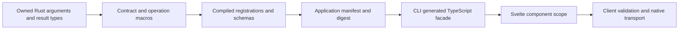
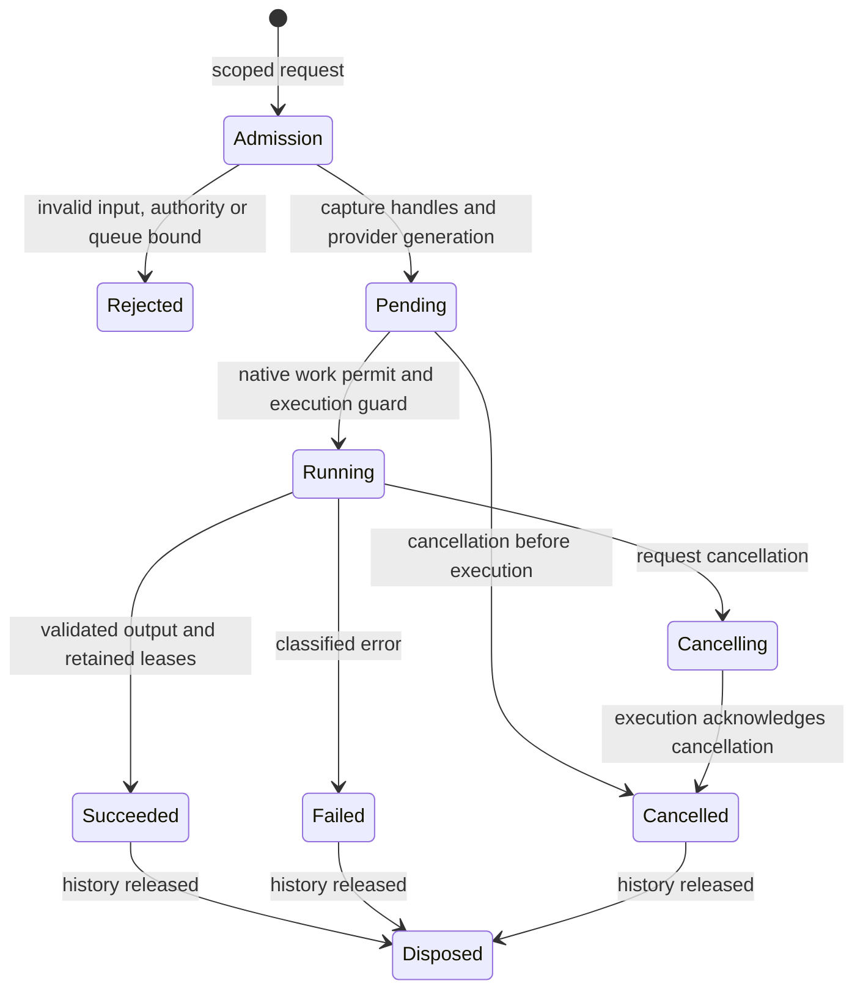
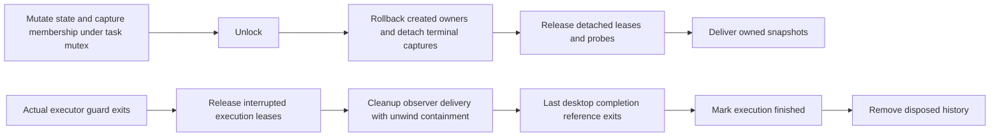

# Interpreting the machinery

This map reflects the interpreted portions of the frozen baseline and the initial corrections. The detailed coverage ledger is retained locally; this document does not imply a complete repository review.

## Authoring and generation

The macros attach the function's documentation, source location, named argument order, effects, work class and optional update contract to its registration. Contract generation checks the portable wire representation rather than treating arbitrary Rust serialization as a safe TypeScript type. It rejects borrowed/unsafe/generic operation signatures and ambiguous declarations. Portable projection is deliberately narrower than arbitrary Serde; broader projection requires its own diagnosis, examples and migration.

Registration prepares schemas once per registration generation. A prepared operation pins its descriptor, executor, validators and provider generation. Replacement can therefore leave already admitted work attached to the old provider while new admissions use a compatible replacement. The manifest digest checks more than operation IDs: source documentation and execution metadata participate in identity.

The CLI runs the consumer's compiled exporter and generates the facade from that manifest. The frontend connects a native root, compares its compiled contract and exposes callable operations. Client-side input checks give authors errors before IPC; they do not authorize native resources. A display path is metadata. Authority is the scoped native handle, admitted and leased by native code.

**Costs and author responsibility.** Rust authors choose effects, scheduling hints, cooperative checkpoints and DTOs. The framework generates wire types, argument wrappers and discovery. Typed executor input is decoded at handle discovery, input validation and execution; the desktop also performs queued admission and execution checks. Some checks defend different entry points; repeated work is a candidate for a prepared admission ticket, not permission to remove validation. Non-Send typed inputs are intentionally decoded before constructing the operation's Send future; caching arbitrary typed input across the queue would narrow the existing API.

**Rationale.** These guarantees are documented in macro errors, executor comments and the authoring guide. The observation that some repeated decoding comes from separating public executor entry points is an inference from callers. It is not a demonstrated runtime necessity for every path.

## Execution, ownership and publication

Admission bounds payload bytes and task count, reserves queue capacity, checks scope ownership, captures capabilities, then enables publication. Failed admission removes its private task and emits the invocation error rather than a misleading cancelled-task event. A job retains inputs and its provider independently of frontend ownership. Result leases belong to native task history, with at most 512 distinct retained resources; disposing a result or its scope releases those leases.

Cancellation requests are not completion. A logical terminal snapshot can precede
actual worker exit, especially after host interruption or coordinator failure.
Scope teardown revokes admission and requests cancellation; task history removal
waits for disposal and actual completion. Admitted leases may outlive the original
owner. Native resource identity and file identity checks must survive optimization.

## Callback settlement and actual completion

`TaskContext` and desktop jobs now separate state mutation, ownership cleanup and
observer delivery. The callback corrections and copying experiment are recorded
in [callback-upgrades.md](callback-upgrades.md).

Unit-returning mutations use the accepted copying path: capture membership under
the mutex and construct a publication snapshot only when observers need one.
After unlocking, transfer that owned value to the final observer. Snapshot-returning
APIs retain their independent caller value. Retained JSON representation, revisions,
callback order and outstanding-delivery behavior stay the same. Paired desktop
timing and allocation evidence supports this narrow change; the embedded cases
exclude WebView IPC and Svelte presentation.

Ordinary subscription and publication still propagate observer panics to their
caller. A registration guard exists before immediate delivery, and an execution
guard exists before Running delivery. A losing execution claimant creates no
guard. State settlement and mandatory ownership cleanup precede notification;
notification failure cannot reverse a successful result or skip queued rollback.
Execution-guard cleanup catches each observer unwind after releasing leases, so
one observer cannot prevent subsequent cleanup delivery. Captured destructors and
panic-payload destructors must remain nonpanicking; aborting panics are outside
this guarantee. Callbacks overlap across publishing threads. Captured membership
preserves an outstanding delivery after unsubscription, while revision checks
protect consumers from late snapshots.

Cancellation probes are shared references: replacement and terminal settlement
detach the task's reference under the mutex and destroy it after unlocking.
An already polling checkpoint retains its clone until that poll completes.
Subscription destruction similarly removes membership under the mutex and drops
the removed callback outside it. These hidden destructor calls are callback
boundaries even when no explicit function invocation appears in the lock scope.

Desktop admission creates a private shared completion guard, transferred to the
blocking executor and cloned into each independent child. The last reader's exit
marks completion. A coordinator panic cannot remove history while a child still
runs. Constructing the completion local before the executor local ensures reverse
drop order releases the core execution guard first. This costs one shared
allocation per admitted job and atomic reference counting for child ownership.
The correctness tests justify this cost; no comparison to the original runtime
has established its timing cost.

Disposal acknowledgement means that local client ownership closed and the native
request was acknowledged. It does not join noncooperative work. Logical state,
executor exit and history removal are distinct boundaries. This also qualifies
the grouped-read promise: one active client load does not prove only one native
read is still executing. No join API is introduced here.

Task updates retain bounded newest snapshots with revisions, separately from progress counters and terminal results. The client rejects stale snapshots and ties projections to scopes. File views offer bounded pages, retain the previous page until acknowledgement, and coalesce discovery changes while that page is outstanding. Selection capture must complete before acknowledging away its page authority.

**Corrected callback ownership.** Task sinks now run after the throttle mutex is released. View sinks are cloned under their mutex and invoked after the guard is destroyed. This permits synchronous cancellation/disposal without deadlocking. Throttling and page ownership are unchanged.

**Remaining interpretation.** Cross-service lock ordering, nested single-worker execution, retained history and the entire batch path are still partial reviews. Folder discovery directly uses the shared worker semaphore instead of the work-service policy (`revenant-sun.10`). Preview disposal records every historical scope (`revenant-sun.9`). Those findings require their own experiments and preservation proofs.

## Svelte publication and settings

`Signal` supplies the Svelte readable-store contract without owning component lifetime. A module-wide queue preserves publication ordering across signals. A write reserves all deliveries before invalidating subscribers; the flush guard prevents nested invalidation writes from overtaking the original publication. Invalidators remain synchronous so Svelte derived stores can wait for all dirty inputs. Unsubscribed consumers are skipped at delivery. Subscriber failures are reported asynchronously while other queued deliveries continue.

The correction captures one subscriber array per write. This is a bounded allocation proportional to the live subscribers. It is accepted for deterministic delivery; no speed advantage has been measured. Store publication itself is synchronous and does not move compute off the webview.

Settings present an immutable local value immediately, load native state asynchronously, and preserve edits made during loading. Flush serializes saves and coalesces later revisions; failed saves retain the latest local value for retry. Scope disposal waits for an already submitted save. Persistence is native, not localStorage.

Native defaults merge missing object fields and retain unknown fields. Arrays keep their length and compare matching positions; an empty default array constrains no element types. The corrected client follows those rules for known fields and array positions, while local edits must contain the declared object fields and remain JSON. Unknown data survives schema evolution; authors should spread the current value when changing a single preference rather than intentionally replacing the entire object.

These inferred constraints are not a schema for every possible TypeScript generic. A null default does not encode a string-or-null union, and an empty array does not encode an element DTO. A wider annotation or cast cannot add runtime information. `revenant-sun.14` records the reproduced limitation and the explicit/generated schema alternatives; correcting client/native agreement has not solved that authoring problem.

The native store serializes writes under one per-instance mutex. It bounds encoded records to 1 MiB and nesting to 128 levels. A successful save syncs a same-directory temporary file and atomically replaces the pathname. Windows uses aligned `usize` storage for the variable-size rename information and refuses unsupported replacement semantics. External readers must share deletion. File replacement is not a guarantee of directory-entry survival after power loss, nor a multi-process transaction.

`Scope` closes local admission synchronously, starts reverse-order resource cleanup, waits for it, then requests native scope disposal. Cleanup errors are reported to the scope rather than rejecting its whole teardown. Children retain their own diagnostic stores; the application root's store describes that root. Queries independently retire their task ownership and await cleanup; failures go through the same scope reporting method. Framework reporting retains the newest 64 records while notifying live subscribers of every failure. This avoids unbounded framework diagnostic history without treating a failed cleanup acknowledgement as proof of native reclamation.

## Graphics and supporting workflows

Native scenes, render scheduling, GPU upload layout, window lifetime, SDK recovery and packaging are substantial parts of this milestone. Their dedicated audit records are not yet complete. Earlier acceptance and benchmark reports remain evidence for the workloads they actually exercised; they do not establish a new baseline/candidate benefit here. In particular, experimental compute retains its prior NO-GO result until equivalent-work evidence overturns it.

Disk scanning, allocation attribution, cleanup plans and disk layouts belong to Strata. The core should provide ownership, admission, bounded work, publication and native surfaces without learning disk-specific policy.
